# WebHaven

**Publish content once. Serve a verified local copy.**

[中文](README.zh-CN.md) · [Guide](docs/GUIDE.zh-CN.md) · [Architecture](docs/ARCHITECTURE.md) · [Performance](docs/VALIDATION.md)

WebHaven gets files from a URL, an S3 bucket, or your program.
**Publisher** archives and publishes each version. **Mirror** checks the files and serves a local copy.
Existing content stays available when Publisher or the delivery store stops.

## Architecture

Publisher and Mirror run as separate processes. They can run on different hosts.

[](docs/images/architecture.svg)

[Diagram source](docs/architecture.mmd)

Mirror switches versions only after it checks every file. Read requests use local storage. They do not call Publisher.

## Performance

Reference workload: 32 concurrent requests, three runs, local HTTP, Apple M5. RPS values are medians.

| Response size | Mirror RPS | P99 latency |
| ------------- | ---------: | ----------: |
| 1 KiB         |     20,421 |     2.50 ms |
| 64 KiB        |     14,225 |     5.03 ms |
| 1 MiB         |  **1,937** |    29.18 ms |

Measured after the Publisher/Mirror refactor: 27 runs, 820,833 requests, zero errors. See [test conditions and current validation](docs/VALIDATION.md).
The separate Nginx/QuickJS routing test is a microbenchmark, not Mirror throughput.

Capture and archive: **79.36 MiB/s**. The full capture-to-activation path took **803 ms** for 32 files of 1 MiB each, with eight download workers. These are three-run medians from a local test source.

## Run a local example

Use Node.js 24 or later. Run these commands from the repository root.

```sh
npm ci
cp .env.example .env
```

Set the same new token in `PUBLISHER_TOKENS` and `WEBHAVEN_TOKEN`. Then use three terminals:

```sh
npm run publisher
npm run mirror
npm run cli -- submit --collection docs --directory examples/site
```

Open <http://127.0.0.1:8080/sites/docs/> after the next sync. The default sync interval is 30 seconds.
The example uses a local delivery directory. [Configure S3 delivery or other sources](docs/GUIDE.zh-CN.md).

## Documentation

| Task                                             | Document                                                  |
| ------------------------------------------------ | --------------------------------------------------------- |
| Capture a URL, read S3, or submit program output | [User guide](docs/GUIDE.zh-CN.md)                         |
| Understand storage, publishing and recovery      | [Protocol](docs/design/PROTOCOL.md)                       |
| Read or change the code                          | [Intent-first code](docs/CODE_STYLE.md)                   |
| Update from Producer / Consumer names            | [Migration](docs/MIGRATION.md)                            |
| Reproduce tests and performance results          | [Validation](docs/VALIDATION.md)                          |
| Report a security issue or contribute            | [Security](SECURITY.md) · [Contributing](CONTRIBUTING.md) |

## Status and license

Prototype, version 0.1.0. Public static content only. Dynamic site replay, login, transactions and multi-tenant isolation are outside the current scope.

Licensed under [Apache-2.0](LICENSE).
