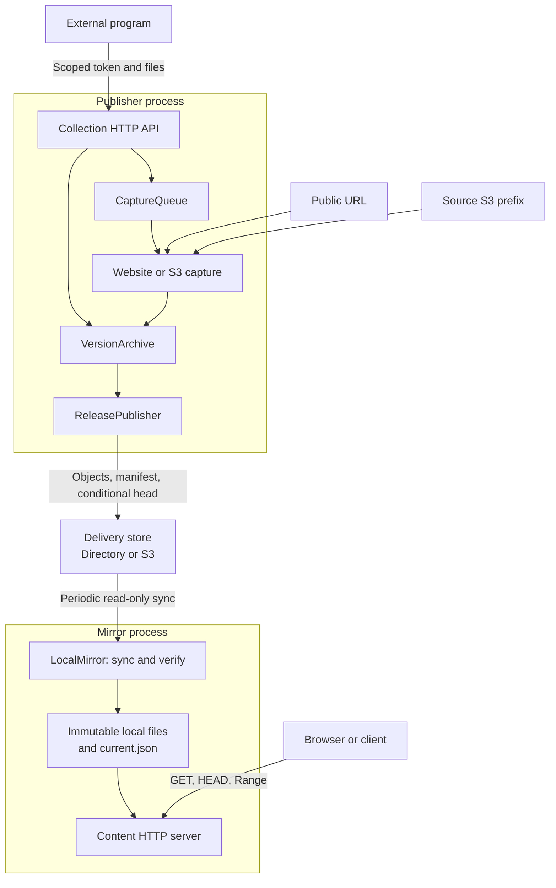

# Technical architecture

Publisher and Mirror are independent Node.js processes. A local directory or an S3-compatible object store connects them. Source S3 and delivery S3 are separate configurations.

## Control and data flow

The arrows describe application data flow. They do not introduce direct calls between the two processes. Publisher routes administrative requests; Mirror serves public content on a different origin.

## Commit points

Publisher first makes objects and the manifest available. `ReleasePublisher.#commitRelease` writes the release record, then conditionally updates its head. A conflict does not replace the old selection. The operation ID supports replay after a lost response.

`LocalMirror.syncCollection` verifies a release and every file, prepares a complete local directory, then activates its `current.json`. A stable URL redirects to a pinned version URL. Page resources therefore stay on one version during an update.

Requests only use verified local files. Publisher or delivery failure can delay a new version; it does not add a remote dependency to an existing read request. Local storage or Mirror failure still requires an operator recovery plan.

## Read the code

| Intention                               | Entry                                                |
| --------------------------------------- | ---------------------------------------------------- |
| Start and recover Publisher             | [Publisher main](../apps/publisher/src/main.js)      |
| Capture, archive and optionally publish | [CaptureQueue](../apps/publisher/src/captures.js)    |
| Capture observed website resources      | [Website capture](../apps/publisher/src/capture.js)  |
| Commit a release                        | [ReleasePublisher](../apps/publisher/src/publish.js) |
| Verify, install and activate a version  | [LocalMirror](../apps/mirror/src/mirror.js)          |
| Redirect or stream verified content     | [Mirror HTTP](../apps/mirror/src/http.js)            |
| Read directory or S3 delivery objects   | [Store adapters](../packages/core/src/store.js)      |

Nginx/QuickJS appear only in the separate routing benchmark. They are not in the current default runtime path.
